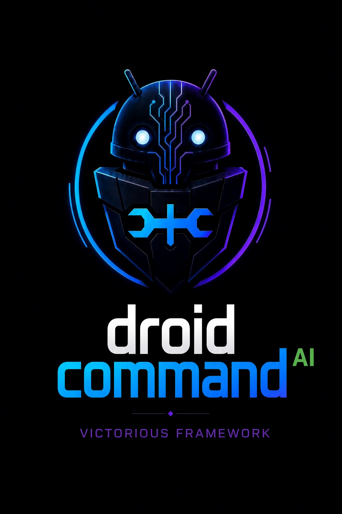
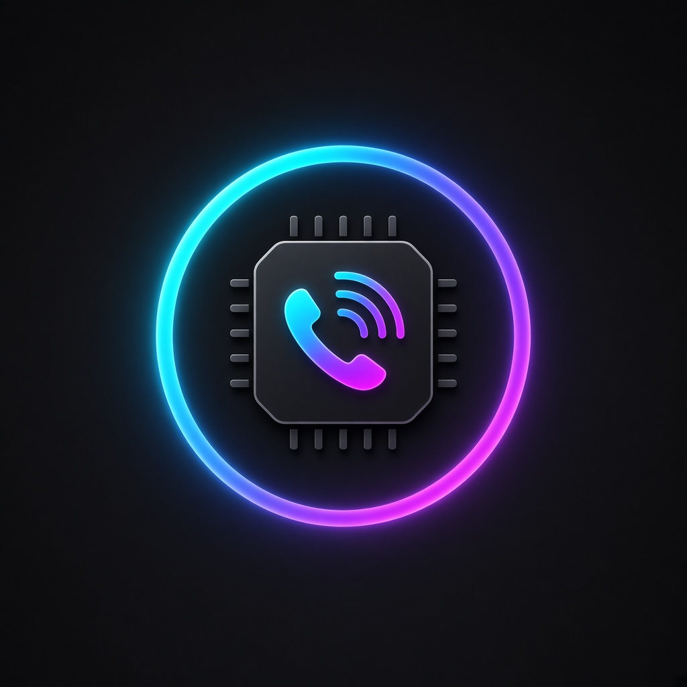
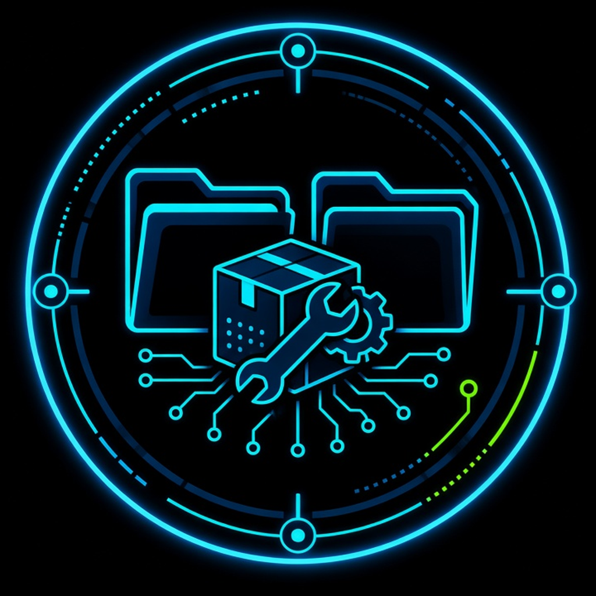
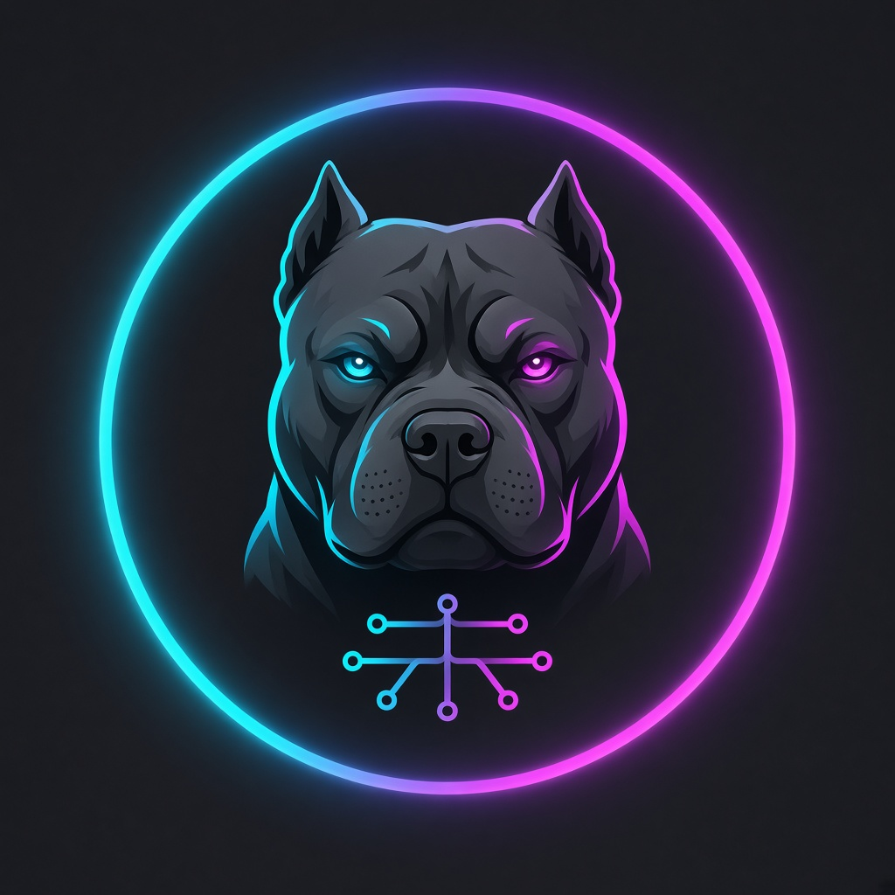

  
  

# Victorious Framework

The Victorious fleet of Android tools, on-device AI agents, and Linux installers. The apps run separately and connect to one hub app, [droidcommand-AI](https://github.com/Victorious93/droidcommand-AI).

- **Fleet manifest:** [fleet-manifest.json](https://victorious93.github.io/fleet-manifest/fleet-manifest.json)
- **Maintainer:** [Don (@Victorious93)](https://github.com/Victorious93)

> [!NOTE]
> Most of these projects are in **early development**. Each repo's README says what has and hasn't been tested on real hardware.

## 🛰️ Victorious fleet

Grouped by how each app connects to the hub. Package IDs are shown where the project defines one. Private repos are listed by name only.

**Controller / Hub**

###  droidcommand-AI

- **Repo:** [Victorious93/droidcommand-AI](https://github.com/Victorious93/droidcommand-AI)
- **Package id:** `ai.droidcommand.app`
- **Purpose:** The fleet controller/brain — remote command and orchestration of every app in the fleet.

###  Pyra Claw

- **Repo:** pyra-claw *(private)*
- **Package id:** *(hub / hardware — not an Android package)*
- **Purpose:** Raspberry Pi 5 + ESP32 command hub that bridges the phone controller to physical devices.

###  VictorModem *(in planning)*

- **Repo:** victormodem *(private)*
- **Package id:** *(in planning / hardware — no confirmed package id yet)*
- **Purpose:** ESP32-S3 + cellular modem board that gives the fleet an independent second line.

**Bound Companions**

###  HackerAI-Commander

- **Repo:** [Victorious93/HackerAI-Commander](https://github.com/Victorious93/HackerAI-Commander)
- **Package id:** `ai.hackerai.companion`
- **Purpose:** Companion to the `hackeraiETC` fork — an AI hacking assistant.

###  Pentest-Swarm-AI

- **Repo:** [Victorious93/Pentest-Swarm-AI](https://github.com/Victorious93/Pentest-Swarm-AI)
- **Package id:** `ai.pentestswarm.companion`
- **Purpose:** Multi-agent pentest swarm companion.

###  EDL-Commander

- **Repo:** [Victorious93/EDL-Commander](https://github.com/Victorious93/EDL-Commander)
- **Package id:** `ai.edlcommander.companion`
- **Purpose:** Safety-first Qualcomm EDL (Emergency Download mode) framework/tool companion.

**External Nodes**

###  rootforge-os

- **Repo:** [Victorious93/rootforge-os](https://github.com/Victorious93/rootforge-os)
- **Package id:** `ai.rootforge.os`
- **Purpose:** Android rooting / root-management app.

###  File-Manager

- **Repo:** [Victorious93/File-Manager](https://github.com/Victorious93/File-Manager)
- **Package id:** `ai.victorious.filemanager` (debug: `ai.victorious.filemanager.debug`) *(rename in progress — repo still uses `ai.victorious.victorfiles`)*
- **Purpose:** Dual-pane power-user file manager aiming to beat MT Manager VIP.

#### Victorious-Keyboard *(logo pending)*

- **Repo:** [Victorious93/Victorious-Keyboard](https://github.com/Victorious93/Victorious-Keyboard)
- **Package id:** `com.victorious.keyboard` *(code namespace still `dev.patrickgold.florisboard` — rename queued)*
- **Purpose:** Custom Android keyboard with integrated media controls.

###  Victorious Flash (Distro Installer)

- **Repo:** [Victorious93/victorious-flash](https://github.com/Victorious93/victorious-flash) *(desktop app)*
- **Package id:** `com.victorious.flash.android` *(desktop app — not an APK)*
- **Purpose:** Desktop app to pick a Linux distro, download its official ISO, and write it to USB.

###  Victorious Mesh

- **Repo:** [Victorious93/victorious-mesh](https://github.com/Victorious93/victorious-mesh)
- **Package id:** `com.victorious.mesh`
- **Purpose:** Secure mesh-networking / VPN Android app.

###  Victorious Browser

- **Repo:** [Victorious93/victorious-browser](https://github.com/Victorious93/victorious-browser)
- **Package id:** `com.victorious.browser`
- **Purpose:** Fleet security / recon browser with web interception.

###  VictorSMS

- **Repo:** victorsms *(private)*
- **Package id:** `com.victorious.sms`
- **Purpose:** Universal messaging app (Matrix-based) with voice cloning and persona learning.

###  VictorLaunch

- **Repo:** victorlaunch *(private)*
- **Package id:** `com.victorious.launch`
- **Purpose:** Nova-class, Lawnchair-based fleet home-screen launcher.

###  VictorSpoof

- **Repo:** victorspoof *(private)*
- **Package id:** `com.victorious.spoof`
- **Purpose:** Legal novelty / prank caller-ID app with strict compliance guardrails.

###  VictorLink64

- **Repo:** [Victorious93/VictorLink64](https://github.com/Victorious93/VictorLink64)
- **Package id:** `org.victoriousframework.victorlink64` *(Kotlin / Jetpack Compose; Android 9+)*
- **Purpose:** Multi-game emulator + play hub — play N64 and SNES games, built-in chess, and multiplayer with friends — in one Android app.

###  VictorCam

- **Repo:** VictorCam *(not public)*
- **Package id:** `com.victorious.cam`
- **Purpose:** OBS-style virtual camera APK.

**Termux / Host**

###  VictorSuite

- **Repo:** [Victorious93/VictorSuite](https://github.com/Victorious93/VictorSuite)
- **Package id:** `com.termux` (lineage; `TERMUX_IPC`)
- **Purpose:** Termux-based Android Linux suite — the fleet home for container-style workloads.

###  KYC-AuditLab / IdentityShield

- **Repo:** [Victorious93/KYC-AuditLab](https://github.com/Victorious93/KYC-AuditLab)
- **Package id:** `com.identityshield.companion`
- **Purpose:** Local KYC / identity audit lab.

###  BakerPi-Installer

- **Repo:** [Victorious93/BakerPi-Installer](https://github.com/Victorious93/BakerPi-Installer)
- **Package id:** *(cross-platform tool — n/a)*
- **Purpose:** Cross-platform tool that installs/flashes in Raspberry Pi imaging style.

### DreamOS-Victorious

- **Repo:** [Victorious93/DreamOS-Victorious](https://github.com/Victorious93/DreamOS-Victorious)
- **Purpose:** Phase 1 Android ROM source integration foundation: host-side profile validator, reproducible source bundle and SHA-256 integrity verifier (not flashable).

**Social / Marketplace Apps**

###  MatchVictorious

- **Repo:** [Victorious93/matchvictorious](https://github.com/Victorious93/matchvictorious)
- **Package id:** `com.victorious.match`
- **Purpose:** Dating app.

###  VictoryPed

- **Repo:** VictoryPed *(private)*
- **Package id:** `com.victorious.victoryped`
- **Purpose:** Social network and marketplace for bully breeders.

**Games**

###  VictorOps Zombies

- **Repo:** victorops-zombies *(private)*
- **Purpose:** Original CODBOZ-style wave-survival zombies game for Android.
